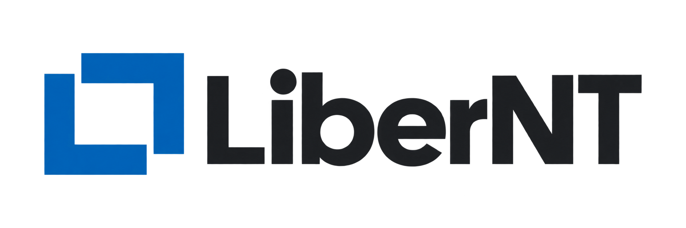
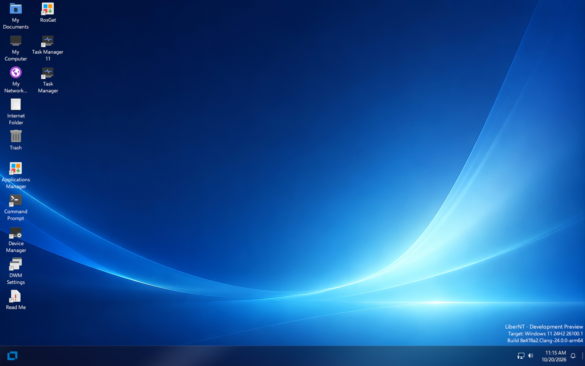

# MinedowsOS (LiberNT fork)
Welcome to this page! MinedowsOS is a LiberNT fork of ReactOS, targeting Windows 11' compatibillity to run apps and drivers, under a same "behaivour" like Windows NT is doing!

Windows 11 is "NT 10.0" and we all want an "open-source" alternative, so there we are. Now we are 3 of them. It isn't still perfect but hey, give Open-source Windows a try!

# Upcoming changes to different development
> [!NOTE]
> The only change you can find right now in this fork, is just a modified **LogonUI.exe** program, that includes a single button to spawn a Command Prompt in the Logon Screen. And anything else is the same, so downloading the source (or any releases) will be the same like already downloading **LiberNT.**

### 1. No FreeLoader!
- **LiberNT** with **ReactOS** uses something called "FreeLDR", which makes any OSes booting simpler, but when working with it in the Kernel mode, it could be a disaster. Windows had something similar back then, with "NTLDR" but after the NT 6.x (Windows Vista) has been released, now we have a whole "System partition" where is stored mostly "bootmgfw.efi" that will display the Legacy boot menu.
- With the **Boot manager** you can use more tools like `bcdedit` or `bcdboot` and any other program to set up custom Boot parameters, just like in modern Windows!

> [!TIP]
> Those "boot parameters" that `winload.efi` will get, is already in the Registry under: `HKEY_LOCAL_MACHINE\SYSTEM\CurrentControlSet\Control` in `SystemStartOptions`

### 2. Better Setup/Installation
- Did you realize, how now the **LiberNT** installation actually works? (If you watching this Mr. Arif :D) Then I had to say... it is so stupid and not even well done.
- Your entire "Windows" contents are just pasted in the whole ISO and after installing, **no packages will be used.**
- Instead your whole ISO contents will be just "pasted" to a selected disk. **Which is really unefficient.**

**The fix?**
- Similar how Windows has it. **By adding something like "DISM"** and support for ***.wim** or ***.esd** files.
- And during the installation, **it will actually install.** Not just "extracting" the files
- With this, people can make **their own Installation** without even TOUCHING the Source-code at all.

If it suppose to be a really similar OS to Windows NT-based, why not implement those existing features to it too? By this, people (like me) can have the exact same experience like they would in normal Windows. Creating "distros", "subsystems" we need to bring the fun back! And this will be one of the many features!

### 3. More control
Reason "why Windows is mostly controversal" is around "having restricted control" (even if that's not really true, but like partically, if you have an Open-source version, now you do have the entire control at anything. And that's also really great)

And now, to the situation of someone just gets in his mind: *Hmm, I'll gonna remove the System32 cuz why not?*
I understand this. And I'm **glad** we can have these "restrictions" in the first place. (Like UAC)

But then "comparing it with Linux" people "want" to do more stuff in their OS. Because "it is theirs, not TrustedInstaller's."
- So, I'll be letting the same NT-based authentication, but I'll give **more control** over SYSTEM account.
- **!!!UNDER A HARD KERNEL TOGGLE!!!**
- We know getting already running "something" as SYSTEM is really easy, so for those "real devs" and guys like me, that loves going into these SYSTEM stuff, then why not "allowing it?" *And then "Loonixers" cant "yap" that they do have more control.*

**Reviving buried features**
Ever wondered why normal Windows 11 has in default in avarage of 52GBs?
Well thats because of how many leftovers has been lefted there. Most of them you don't even realize it is even capable of. And **that's wrong.**

With this, I want to then "at least" use Windows in its 100% and "MinedowsOS" will give you all of the power to do so. (Without even touching the source-code.)
**Accessing the full Root by default.** - Windows' main root "isn't" C:\ but "\" (in the ntoskrnl)
  - *Under SYSTEM user, if toggled.*

**Full control over custom WinStations and Win32 Desktops**
  - In normal Windows, you are rn. in `WinSta0` and desktop `Default` and creating/switching to more of them, requires **even higher privilage than SYSTEM.**
  - But WinStations can be actually useful!
    - Take for exp. with them, you can have multiple "desktops" running seperatly **without using any other PC.**
    - You can use just the whole Main PC (if you have enough RAM xd)
    - And by each Monitor, you can connect its unique `WinStation` with its own Mouse/Keyboard input in the same device!

**More customizations**
  - _Don't like the current Boot screen animation?_ Change it!
  - _Don't like the current Login screen?_ Ja na türlich!
  - _Don't like the current Shell?_ Of course change it as well!

**Built-in modding!**
  - If you ever heard about **Windhawk** before, then here it will be supported too!
  - You can create your own Mods, not even to the **User mode only.** But also to the **Kernel mode too!**
    - That will be really useful and much easier, to just bring anything else by somesort of a "Driver"
    - **Hmm, and for what it might useful be?**
      - Maybe, you want to experiment and want to try "disabling BSOD" and killing csrss.exe process?
      - Trying to make your somesort of "Distro" with your custom user space and running the same NT kernel?
      - The posibilities are **endless.** And with all of the features, you can have as much control as much you'll have in Linux!

_Coming soon!_

### 4. Driver fixes
- Even now if LiberNT does the Basic Driver handling really well, then it is still not perfect..
- As **VMWare tools** still doesn't work, and I'll be testing some of my real hardware as well to try improve the stuff for myself.

5. **Classic NT way**
- That means **Win32 always first!**
- Any other "WinUI" or "UWP" apps can be supported, but not developed into the OS itself.
  - This means, MinedowsOS will be developed the "old way" like Windows developers did in Windows 7 era. Creating, improving features that are already there! Not adding more slop at the top.
  - Which means more freedom, more learning skills and more ways to improve your own environment how you'll like! 

**That means what?**
- For exp. This build has "Settings App" instead "Control Panel", then **Control Panel** will be first and Settings app will go away.
- Shell will **NEVER** have any WinUI garbage. Just pure communication with the whole OS, as how a shell suppose to work. Not being just a "container" that Microslop can serve you Ads.

6. **More modernizing features**
- **Any new feature avalible?** - I'll be trying to make something like "MinedowsOS Updates" that will be more customizable, controlable and can be made/review in the fullest detail by anyone! Without "reinstalling" the whole OS!
- *Coming soon...*

## Why did you fork it?
"MinedowsOS" was my idea already in year 2020, when I really liked to learn about how Windows works, by this also started making my own apps (like KrrShell and bunch of Windows utillities) and I love digging how Windows NT works. Even if someone can say... "It is a mess" - I don't care. I like Windows and I will. And to prove it, I'll fork now already this "kinda new" really great alternative to Windows 11.

### Further history and plans in year 2020 of making a "custom os".
- When I was a kid, I always liked Windows 7, as I do have really great memories out of it. Played Purble Place etc. But when I got my first ever PC in 2017, I was shocked, that Windows 10 on it... was "bad" didn't have any Aero etc. I don't even want to straight up install Windows 7, cuz "my young me" was scared if the PC will break.
- Then I started learning. First the entire history, how Windows works, up from ntoskrnl to the whole subsystem... Well not in that time really, that started in "AI era" in 2023
- But when I discovered **Gamemaker** then I even created some of my "Windows clones" that had functional Login System, even some "apps" inside :D
- And also "created" my own, "Windows KS" (based of my name "KriStián") and I had a vision that when I send it to Microsoft, we can have another version of Windows based exactly what I wanted...
  - *Well of course nobody answered, but the idea was still not discarded.*
- After I was getting smarter in Windows, I achieved already some "great" modifications to personalize it how I want etc.
- But then also the "Windows hate" drama started... Anyone just wants to switch to Linux, without even staying and seeing what great capabillities the Windows NT can really do.
- So in 2021, I had a vision about "Minedows" as it is "Minecraft and Windows" together.
  - *Fun fact, before year 2021, my YouTube channel has been called "kristiankrista11" first, then after I made the name idea, I put it to my channel name as "reference" that sometimes it becomes true!*
- Then... I was making already some "graphics", test programs but still. I needed a kernel or already an userspace to start. First I think about using Windows 11 LTSC or even tried other builds, like Optimum 11 or even ValidationOS - really stripped down versions of existing Windows. But then I scrapped it, because "it will be illegal" to contribute the Microsoft's own ISO.
- And then I found **LiberNT** - Finally a place, that will be "legal" and totally open-source, exactly what I wanted!

---------------------------------------------

Then for now (as I would have time) let the original README under this text. As to make it clear, "I don't want to steal it or anything."
All the thank you goes to the Owner of LiberNT!

<p align="center">
  
</p>

> [!IMPORTANT]
> LiberNT is in active development. The builds on the [Releases](https://github.com/LiberNT/LiberNT/releases) page are Debug pre-releases for testing: run them in a virtual machine or on spare hardware, not on a computer you depend on.

<div align="center">

# [LiberNT](https://libernt.com)
### A free NT operating system

**Built out of love for the NT architecture. Windows® 11 compatible, for amd64, arm64 and riscv64.**

[](https://github.com/LiberNT/LiberNT/actions/workflows/build.yml)
[](#license)
[](https://discord.gg/BpcKg7FZ2)
[](https://matrix.to/#/#libernt:matrix.org)


<br>

[](https://github.com/LiberNT/LiberNT/releases)

</div>

## Sponsors

<p align="center">
  <a href="https://github.com/sponsors/ahmedarif193">
    
  </a>
</p>

---

<p align="center">
  
</p>

<p align="center"><sub>The LiberNT desktop on arm64, from build nt10.0-043-2555 in QEMU</sub></p>

---

LiberNT is a free NT operating system. The name says it: *liber* is Latin for **free**. It targets **Windows® 11 compatibility**, with room for freestyle and experimental features.

LiberNT brings extensive work on kernel-space components and drivers, aimed at stability and modern hardware, and it focuses on 64-bit platforms: **amd64, arm64 and riscv64**.

Our goal is a system that stays maintainable in the long run: **stable, reliable and efficient**, running on embedded devices too, and able to support every feature a modern operating system should have.

> [!NOTE]
> New to NT? **NT** is the architecture behind every modern version of Windows: its kernel, driver model and system services. LiberNT is a free operating system built on that architecture, and Windows 11 is the reference it measures itself against.

---

## Table of Contents

- [What LiberNT Includes](#what-libernt-includes)
- [Supported Platforms](#supported-platforms)
- [Getting Started](#getting-started)
  - [Step 1: Download a Build](#step-1-download-a-build)
  - [Step 2: Boot It](#step-2-boot-it)
  - [Step 3: Install LiberNT](#step-3-install-libernt)
- [Building LiberNT Yourself](#building-libernt-yourself)
- [Build Hosts](#build-hosts)
- [Project Structure](#project-structure)
- [Contributing](#contributing)
- [Use of AI](#use-of-ai)
- [License](#license)
- [About](#about)

---

## What LiberNT Includes

LiberNT brings modern hardware and platforms to the NT architecture.

| Feature | What it means for you |
| --- | --- |
| **64-bit first** | The kernel, HAL and FreeLoader run on amd64, arm64 and riscv64. |
| **UEFI boot** | Boots on UEFI firmware, with a GOP framebuffer and early display support. The preinstalled disk boots with UEFI or BIOS. |
| **Modern buses and storage** | PCIe, PCI, Plug and Play, USB with xHCI, SD/eMMC, and storage and bus drivers. |
| **Board support** | Real boards, including the Raspberry Pi and its RP1 I/O controller. |
| **The Windows 11 driver model** | Windows 11 (NT10) compatibility and driver-model work, checked against Windows 11 itself. |
| **Graphics and x86 apps on Arm** | The graphics driver model with Mesa, and WoW64 with FEX, are build options you can switch on. |
| **LiberNT Setup** | Lists drives the way Windows Setup does, creates, deletes, formats, shrinks and extends partitions, and installs LiberNT on NTFS with the EFI system partition it needs. |
| **Your own build** | `menuconfig` lets you choose the target, compiler and build type, and switch features on or off. |

> [!TIP]
> Each build on the [Releases](https://github.com/LiberNT/LiberNT/releases) page lists what changed since the previous one.

---

## Supported Platforms

| Architecture | Prebuilt images | Build from source | Notes |
| --- | :---: | :---: | --- |
| **amd64** | ✓ | ✓ | Clang (default) or GCC |
| **arm64** | ✓ | ✓ | Includes Raspberry Pi support |
| **riscv64** | ✓ | ✓ | A separate image is built for JH7110 boards |
| **i386** | | ✓ | 32-bit x86 |

Release builds also include PowerPC images.

---

## Getting Started

### Step 1: Download a Build

Every build on the [Releases](https://github.com/LiberNT/LiberNT/releases) page comes as one ZIP file per image and architecture:

| File | What it is |
| --- | --- |
| `bootcd-iso-…-<arch>-…zip` | `bootcd.iso`, a CD image that runs LiberNT or starts LiberNT Setup |
| `LiberNT-img-…-<arch>-…zip` | `LiberNT.img`, a disk with LiberNT already installed |
| `LiberNT-vhd-…-<arch>-…zip` | `LiberNT.vhd`, the same preinstalled disk for VHD-based virtual machines |
| `LiberNT-vhdx-…-<arch>-…zip` | `LiberNT.vhdx`, the same preinstalled disk for Hyper-V Generation 2 |

> [!NOTE]
> These are Clang Debug builds, made by GitHub Actions from the `main-nt10` branch.

### Step 2: Boot It

The quickest way to try LiberNT is the preinstalled disk:

1. Unzip `LiberNT.img` (or `LiberNT.vhd`)
2. Start it in a virtual machine such as **QEMU**, or use the VHD in **VirtualBox** or a **Hyper-V** Generation 1 virtual machine. Hyper-V Generation 2 takes only `LiberNT.vhdx`, with Secure Boot turned off
3. Or write `LiberNT.img` to a USB drive or an SD card and boot the machine from it. It boots with UEFI or BIOS

> [!CAUTION]
> Writing `LiberNT.img` to a USB drive or an SD card erases everything on it. Double-check the target device first.

### Step 3: Install LiberNT

Boot `bootcd.iso` in a virtual machine or on a PC, and follow the instructions of **LiberNT Setup**.

The preinstalled disk also carries LiberNT Setup. Run `C:\<architecture>\libernt.exe`, for example `C:\arm64\libernt.exe`, to install LiberNT on another disk from the running system.

> [!CAUTION]
> Setup can delete and format partitions. Back up anything important on the target disk before you install.

See [INSTALL.md](INSTALL.md) for the full installation guide.

---

## Building LiberNT Yourself

LiberNT builds with RosBE, a cross-build toolchain. The steps below work on Linux and macOS, and on Windows through WSL2.

### 1. Install the toolchain

You need Git, CMake, Ninja and a C/C++ compiler for your own machine. RosBE adds the compilers that build LiberNT.

```sh
curl -fsSL https://raw.githubusercontent.com/LiberNT/libernt-build-toolchain/main/rosbe-unix-bootstrap.sh | sh
```

> [!TIP]
> On Windows, we suggest WSL2. Install it with `wsl --install`, open the Linux terminal it adds, and follow the Linux steps there. Keep the source inside the Linux file system rather than under `/mnt/c`, where builds run slower.

### 2. Get the source

```sh
git clone https://github.com/LiberNT/LiberNT.git
cd LiberNT
```

> [!NOTE]
> The first configure run also fetches the submodule and external sources the build needs.

### 3. Configure

```sh
./configure.sh
```

With no options, this sets up an AMD64 Debug build with Clang in the folder `output-Clang-amd64-debug`. The folder name always follows the pattern `output-<compiler>-<architecture>-<debug|release>`.

| Option | What it does |
| --- | --- |
| `-a`, `--arch <arch>` | Chooses the target architecture: `amd64` (default), `i386`, `arm64` or `riscv64`. |
| `--clang` | Builds with Clang/LLVM from RosBE. This is the default. |
| `--gcc` | Builds with GCC from RosBE instead of Clang. The macOS RosBE does not include GCC. |
| `-r`, `--release` | Makes an optimized Release build. Without it you get a Debug build, which is easier to debug. |
| `menuconfig` | Opens a menu to choose optional components first. Your choices are kept in the output folder. |
| `makefiles` | Uses `make` instead of Ninja. |
| `--no-feeds-update` | Skips fetching the external sources listed in `feeds.conf`, for example when offline. |
| `-D<name>=<value>` | Passes a setting straight to CMake. |

For example:

```sh
./configure.sh -a arm64              # ARM64 Debug build with Clang
./configure.sh -a i386 --gcc         # 32-bit x86 build with GCC
./configure.sh -a amd64 --release    # optimized AMD64 build
```

For a more personalized build, add `menuconfig`:

```sh
./configure.sh menuconfig
```

It opens a menu, much like the Linux kernel's, where you choose the target, compiler and build type, and switch features on or off: code generation and tuning, graphics driver model and Mesa, WoW64 and FEX, kernel debugging, test runs and more. Press `?` on any option for help, `S` to save and `Q` to quit. Your choices are saved in the output folder and used every time you configure it again.

### 4. Build

Go to the output folder and run Ninja with the target you want:

```sh
cd output-Clang-amd64-debug
ninja liberntimg
```

| Command | Creates | Use it to |
| --- | --- | --- |
| `ninja bootcd` | `bootcd.iso` | Install LiberNT from a CD image, in a virtual machine or on a PC. |
| `ninja liberntimg` | `LiberNT.img` | Boot a disk with LiberNT already installed. Start it in a virtual machine such as QEMU, or write it to a USB drive or SD card. It boots with UEFI or BIOS. |
| `ninja liberntvhd` | `LiberNT.vhd`, `LiberNT.vhdx` | Use the same preinstalled disk in virtual machines: the VHD in VirtualBox and Hyper-V Generation 1, the VHDX in Hyper-V Generation 2, which does not take VHD disks. |

Each target builds everything it needs first, and the files are written to the output folder.

---

## Build Hosts

| Host | Compilers | Notes |
| --- | --- | --- |
| **Linux** x86_64 / aarch64 | Clang and GCC | The full RosBE toolchain |
| **macOS** Intel / Apple Silicon | Clang | RosBE has no GCC build for macOS |
| **Windows** | Clang and GCC | Through WSL2, following the Linux steps |

On every host, install Git, CMake, Ninja, Flex and Bison from your package manager. RosBE provides only the cross compilers. Prebuilt toolchains live in [LiberNT/libernt-build-toolchain](https://github.com/LiberNT/libernt-build-toolchain).

---

## Project Structure

```text
LiberNT/
├── base/            # Applications, services, setup and the shell
├── boot/            # FreeLoader, boot data and boot images
├── bootloader/      # Boot manager, Windows loader, UEFI and Open Firmware support
├── dll/             # User-mode DLLs, including ntdll and the Win32 libraries
├── drivers/         # Kernel-mode drivers: buses, storage, file systems, network, input and more
├── hal/             # Hardware abstraction layers for x86, Arm, Arm64, PowerPC and RISC-V
├── media/           # Fonts, themes, INF files, sounds and branding
├── modules/         # Optional applications, tests and wallpapers
├── ntoskrnl/        # The NT kernel and executive
├── sdk/             # Headers, libraries and build tools
├── submodules/      # Recipes and patches for external components
├── subsystems/      # CSRSS and the Windows subsystem
├── win32ss/         # win32k, USER, GDI and display drivers
├── configure.sh     # Sets up a build on Linux, macOS and WSL2
└── configure.cmd    # Sets up a build on Windows
```

---

## Contributing

Report bugs and suggest features in [Issues](https://github.com/LiberNT/LiberNT/issues), and find guides and notes in the [Wiki](https://github.com/LiberNT/LiberNT/wiki).

See [CONTRIBUTING.md](CONTRIBUTING.md) and [PULL_REQUEST_MANAGEMENT.md](PULL_REQUEST_MANAGEMENT.md). If you're planning a larger change, ask in [Issues](https://github.com/LiberNT/LiberNT/issues) or on [Discord](https://discord.gg/BpcKg7FZ2) first.

> [!WARNING]
> **Legal notice:** If you have seen proprietary Microsoft Windows source code (including but not limited to the leaked Windows NT 3.5, NT 4, 2000 source code and the Windows Research Kernel), your contribution won't be accepted because of potential copyright violation.

---

## Use of AI

We want to make it clear: AI is part of how LiberNT is built. It helps us review and write code, and everything it writes is then reviewed by a human. Before anything reaches the main branch, a person runs and validates the end-to-end tests. We care about this project too much to let a regression slip through.

It also helps us read documentation, extract definitions and fix bugs. For any given bug, it compares what the official Microsoft Learn documentation says with what our function actually does, so we can see exactly where our behavior differs.

Like any other tool, AI is there to help us achieve our goals. It follows the same rules we hold ourselves to, set out in [AGENTS.md](AGENTS.md):

- We build from the Windows SDK and WDK headers, Windows 11 public symbols, Microsoft documentation and black-box runs on Windows 11.
- We stay clean-room: we never transcribe disassembled or decompiled Windows code, and we never copy GPL code from Linux.
- A fix is only a fix once we have seen it work in a real boot or test run. Once tests pass, a future CI will keep them passing and preserve our overall progress.
- We compare our test results check by check with the same tests run on Windows 11.

> [!TIP]
> If you use AI in your own contributions, you are welcome here too. Just tell us in the pull request which parts it helped with and how you tested them. That honesty is all we ask.

---

## License

LiberNT is licensed under the [GNU GPL 3.0](COPYING). Code inherited from other projects keeps the licence stated in its file headers, most of it GPL 2.0 or later. The GPL 2.0, LGPL 2.1 and BSD texts those files refer to are in [COPYING2](COPYING2), [COPYING.LIB](COPYING.LIB) and [COPYING.ARM](COPYING.ARM).

The changes made in LiberNT are Copyright © 2026 the LiberNT contributors. Inherited and third-party code keeps the copyright notices of its authors. See [CREDITS.md](CREDITS.md).

LiberNT is an independent project. It is not affiliated with, endorsed by or sponsored by Microsoft. Windows® is a registered trademark of Microsoft Corporation.

---

## About

LiberNT is built by the **LiberNT contributors**, started and maintained by [Ahmed Arif](https://github.com/ahmedarif193).

- [Visit the LiberNT organization](https://github.com/LiberNT)
- [Website](https://libernt.com)
- [Download the latest build](https://github.com/LiberNT/LiberNT/releases)
- [Wiki](https://github.com/LiberNT/LiberNT/wiki)
- Chat on [Discord](https://discord.gg/BpcKg7FZ2) or [Matrix](https://matrix.to/#/#libernt:matrix.org)
